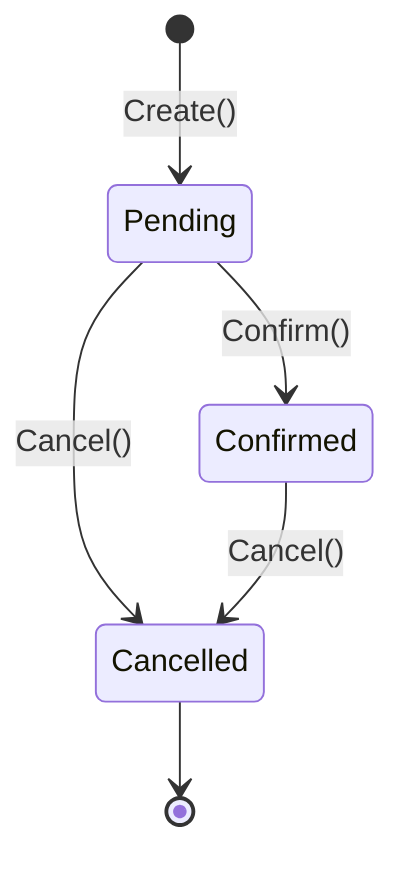
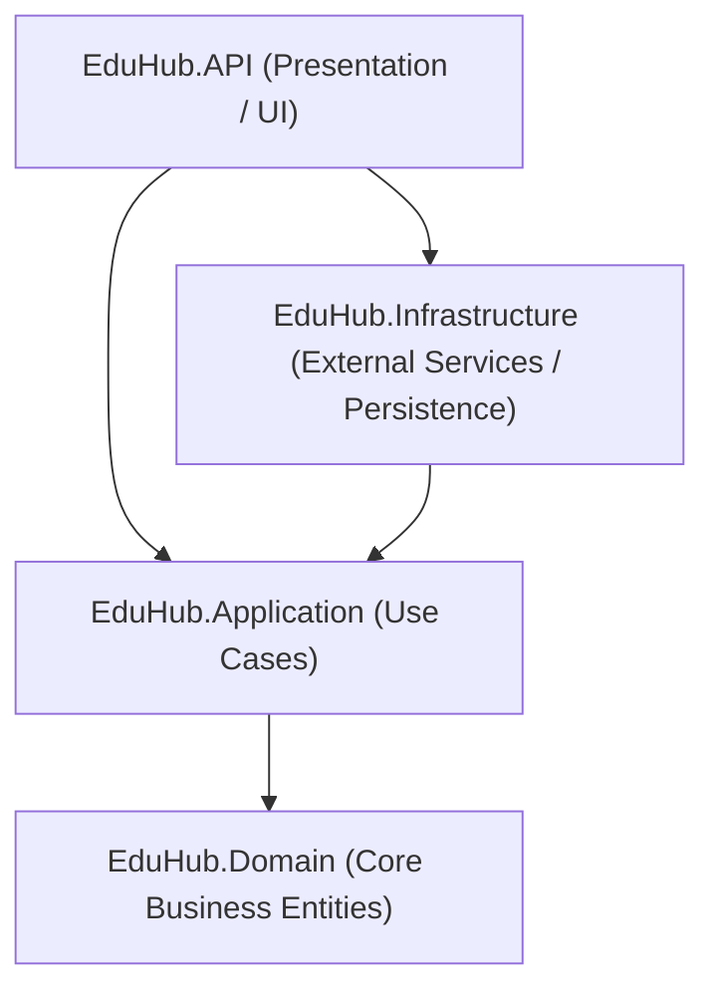

# BÀI LÀM KIỂM TRA GIỮA HỌC PHẦN
**Học phần:** Phát triển phần mềm hướng đối tượng - IN4211  
**Mã đề:** ĐỀ SỐ 02  
**MSSV:** 0024418084  
**Nhánh làm bài:** `midterm/0024418084`  

---

## Câu 1a

### Bốn trụ cột của lập trình hướng đối tượng (OOP):

1. **Đóng gói (Encapsulation):**
   - **Giải thích:** Gom nhóm các trường dữ liệu và các hành vi thao tác trên dữ liệu đó vào trong một lớp; che giấu trạng thái nội bộ (sử dụng access modifier `private`, `protected`) và chỉ cho phép truy cập, sửa đổi thông qua các phương thức công khai được kiểm soát chặt chẽ với các ràng buộc nghiệp vụ hợp lệ.
   - **Minh hoạ trong bài:**
     - **Tệp:** `EduHub.Domain/Entities/Registration.cs` (thuộc project `EduHub.Domain`)
     - **Lớp:** `Registration` (các thuộc tính `Id`, `MemberId`, `EventId`, `RegisteredAt`, `Status` đều có setter `private`; constructor `private`; chỉ được khởi tạo qua factory method `Create(...)` và thay đổi trạng thái qua các phương thức nghiệp vụ `Confirm()`, `Cancel()`).

2. **Kế thừa (Inheritance):**
   - **Giải thích:** Cho phép một lớp con (derived class) tái sử dụng cấu trúc thuộc tính và phương thức từ một lớp cha (base class), giảm trùng lặp mã nguồn và xây dựng mối quan hệ có thứ bậc logic.
   - **Minh hoạ trong bài:**
     - **Tệp:** `EduHub.Domain/Entities/Entity.cs` và `EduHub.Domain/Entities/Member.cs` (thuộc project `EduHub.Domain`)
     - **Lớp:** Lớp trừu tượng `Entity` định nghĩa thuộc tính cơ sở `Id`, các lớp thực thể `Member`, `Registration`, `Event` kế thừa từ lớp `Entity`.

3. **Đa hình (Polymorphism):**
   - **Giải thích:** Khả năng các đối tượng khác nhau phản hồi theo các cách khác nhau khi nhận cùng một lời gọi phương thức (qua interface hoặc lớp cơ sở). Giúp hệ thống linh hoạt, dễ dàng hoán đổi hành vi lúc runtime.
   - **Minh hoạ trong bài:**
     - **Tệp:** `EduHub.Infrastructure/Notifications/EmailNotificationService.cs` và `EduHub.Infrastructure/Notifications/SmsNotificationService.cs`
     - **Lớp:** Hai lớp `EmailNotificationService` và `SmsNotificationService` cùng hiện thực interface `INotificationService` với phương thức `Send(string message)`. Lớp `EventService` chỉ phụ thuộc vào abstraction `INotificationService` và gọi `Send(...)` mà không cần biết kênh gửi thực tế bên dưới là Email hay SMS.

4. **Trừu tượng (Abstraction):**
   - **Giải thích:** Tập trung vào các đặc tính và hành vi cốt lõi của đối tượng, định nghĩa "làm cái gì" (contract/interface) thay vì "làm như thế nào" (implementation detail). Ẩn giấu chi tiết kỹ thuật phức tạp đối với phía gọi.
   - **Minh hoạ trong bài:**
     - **Tệp:** `EduHub.Application/Interfaces/IEventRepository.cs`
     - **Lớp/Interface:** Interface `IEventRepository`. `EventService` và `EventsController` thao tác dữ liệu thông qua các phương thức trừu tượng `Add`, `GetById`, `GetByClubId`, `Delete` mà không cần biết dữ liệu được lưu trong bộ nhớ (`InMemoryEventRepository`) hay cơ sở dữ liệu vật lý.

---

## Câu 1b

### Hai vấn đề của lớp `Member` chưa đóng gói:

1. **Vấn đề 1 - Setter là `public` (`public Guid Id { get; set; }`, `public string Email { get; set; }`):**
   - Cho phép mã nguồn bên ngoài can thiệp và sửa đổi trực tiếp dữ liệu của đối tượng bất kỳ lúc nào mà không qua bất kỳ sự kiểm tra tính hợp lệ nào. Ví dụ: `m.Email = "abc"` (chuỗi không đúng định dạng email, không có ký tự `@`) vẫn được gán thành công, dẫn đến trạng thái dữ liệu của đối tượng bị sai lệch và vi phạm tính toàn vẹn nghiệp vụ.
2. **Vấn đề 2 - Constructor mặc định không tham số là `public` (`public Member() { }`):**
   - Cho phép khởi tạo một thực thể `Member` ở trạng thái rỗng hoặc không hợp lệ (`Id` bằng `Guid.Empty`, `Email` là `null`) mà không qua bất kỳ kiểm tra hợp lệ nào khi tạo mới đối tượng.

### Cách khắc phục:
- Ẩn setter bằng `private set`.
- Đặt constructor ở phạm vi `private`.
- Cung cấp Factory Method tĩnh `Member.Create(...)` để kiểm tra điều kiện email không được rỗng và bắt buộc phải chứa ký tự `@`.
*(Đã cài đặt hoàn chỉnh tại `EduHub.Domain/Entities/Member.cs` trong project `EduHub.Domain`).*

---

## Câu 2a

### Sơ đồ trạng thái của `Registration`:



**Mô tả:**
- Phiếu tạo mới bằng `Registration.Create(memberId, eventId)` có trạng thái ban đầu là `Pending`.
- Từ `Pending`, gọi `Confirm()` chuyển sang `Confirmed`.
- Từ `Pending` hoặc `Confirmed`, gọi `Cancel()` chuyển sang `Cancelled`.
- Trạng thái `Cancelled` là trạng thái cuối: mọi nỗ lực gọi `Confirm()` hoặc `Cancel()` khi đang ở trạng thái `Cancelled` đều ném ra ngoại lệ `InvalidOperationException`.

---

## Câu 3a

### Ba nguyên lý SOLID mà lớp `EventService` (Đoạn mã 2) vi phạm:

1. **SRP (Single Responsibility Principle - Nguyên lý đơn trách nhiệm):**
   - **Dòng vi phạm:** Dòng 6-7 (kiểm tra hợp lệ dữ liệu), dòng 8-9 (kết nối và truy cập CSDL trực tiếp), dòng 10 (ghi log ra tệp văn bản), dòng 11-14 (gửi thông báo cho người dùng).
   - **Giải thích:** Lớp `EventService` đang gánh vác quá nhiều trách nhiệm (validate, persistence, logging, notification). Một lớp chỉ nên có một lý do duy nhất để thay đổi. Việc thay đổi cơ sở dữ liệu, định dạng ghi log hoặc kênh gửi thông báo đều buộc phải sửa đổi lớp này.

2. **OCP (Open/Closed Principle - Nguyên lý Đóng/Mở):**
   - **Dòng vi phạm:** Dòng 11-14 (`if (channel == "email") ... else if (channel == "sms") ...`).
   - **Giải thích:** Lớp chưa đóng với việc sửa đổi và chưa mở với việc mở rộng. Mỗi khi hệ thống cần hỗ trợ thêm kênh thông báo mới (ví dụ: Push Notification, Telegram, Zalo...), ta buộc phải sửa đổi trực tiếp mã nguồn của `EventService` bằng cách thêm nhánh `else if`, tiềm ẩn rủi ro gây lỗi cho mã nguồn cũ đã ổn định.

3. **DIP (Dependency Inversion Principle - Nguyên lý đảo ngược phụ thuộc):**
   - **Dòng vi phạm:** Dòng 8 (`new SqlConnection`), dòng 10 (`File.AppendAllText`), dòng 12 (`new EmailSender()`), dòng 14 (`new SmsSender()`).
   - **Giải thích:** Module cấp cao (`EventService`) đang phụ thuộc trực tiếp vào các module cấp thấp và các lớp cụ thể (`SqlConnection`, `File`, `EmailSender`, `SmsSender`) thông qua từ khoá `new`, thay vì phụ thuộc vào các abstraction (interface như `IEventRepository`, `INotificationService`). Điều này tạo ra sự gắn kết chặt (tight coupling), khiến mã nguồn khó kiểm thử độc lập (không thể mock trong unit test) và khó thay thế hạ tầng kỹ thuật.

---

## Câu 4b

### Phân biệt `git merge` và `git rebase`:

| Tiêu chí | `git merge` | `git rebase` |
|---|---|---|
| **Cơ chế hoạt động** | Tạo một commit gộp mới (merge commit) nối hai nhánh lại với nhau, giữ nguyên toàn bộ commit của cả hai nhánh. | Viết lại lịch sử bằng cách lấy các commit của nhánh hiện tại và áp dụng lần lượt lên đỉnh của nhánh đích. |
| **Cấu trúc lịch sử** | Lịch sử dạng cây (có các nhánh phân nhánh và hợp nhất), phản ánh chính xác trình tự thời gian thực tế. | Lịch sử dạng đường thẳng (linear history), sạch sẽ, dễ theo dõi commit log. |
| **Mã băm commit (Hash)** | Không làm thay đổi mã hash của các commit đã có trước đó. | Tạo ra các commit mới với mã hash mới (viết lại lịch sử commit). |

### Khi nào không nên dùng `git rebase`:
- **Không nên dùng rebase trên các nhánh dùng chung (public/shared branches) như `main` hoặc `develop`:** Vì việc rebase sẽ làm thay đổi toàn bộ mã băm (commit hash) của các commit đã được đẩy lên remote. Nếu các thành viên khác trong nhóm đang làm việc dựa trên các commit cũ đó, việc viết lại lịch sử sẽ gây xung đột nghiêm trọng (conflict), làm đảo lộn lịch sử Git của nhóm và rất khó khôi phục.

---

## Câu 5a

### Chiều phụ thuộc giữa các project trong Clean Architecture:

Theo quy tắc phụ thuộc (Dependency Rule) của Clean Architecture, mọi phụ thuộc mã nguồn chỉ được phép hướng vào trong, hướng về phía Domain:



### Bốn lớp (project) và các thành phần chứa bên trong:

| Lớp (Project) | Vai trò | Các thành phần chứa trong bài làm |
|---|---|---|
| **Domain** (`EduHub.Domain`) | Thực thể và quy tắc cốt lõi của doanh nghiệp | `Entity`, `Member`, `Registration`, `RegistrationStatus`, `Event` |
| **Application** (`EduHub.Application`) | Nghiệp vụ ứng dụng (Use Cases & Interfaces) | `IEventRepository`, `INotificationService`, `INotificationServiceFactory`, `EventService` |
| **Infrastructure** (`EduHub.Infrastructure`) | Triển khai hạ tầng và chi tiết kỹ thuật | `InMemoryEventRepository`, `EmailNotificationService`, `SmsNotificationService`, `NotificationServiceFactory` |
| **API** (`EduHub.API`) | Tầng giao diện / Điểm vào ứng dụng | `EventsController`, `Program.cs` |

---

## Câu 5b

### Vì sao project `EduHub.Domain` không được tham chiếu tới `EduHub.Infrastructure`:

1. **Tuân thủ quy tắc phụ thuộc (Dependency Rule) của Clean Architecture:** Tầng Domain là hạt nhân chứa các quy tắc nghiệp vụ cốt lõi của doanh nghiệp (Enterprise Business Rules), phải hoàn toàn độc lập và không phụ thuộc vào bất kỳ framework, công nghệ lưu trữ, thư viện bên ngoài hay chi tiết hạ tầng nào.
2. **Tuân thủ nguyên lý Đảo ngược phụ thuộc (DIP):** Tầng nghiệp vụ cấp cao không được phụ thuộc vào tầng hạ tầng cấp thấp; ngược lại tầng hạ tầng (`Infrastructure`) phải phụ thuộc vào các interface được định nghĩa ở các tầng bên trong (`Application`).
3. **Đảm bảo tính linh hoạt và dễ kiểm thử:** Giúp tầng Domain có thể tồn tại và chạy độc lập, dễ dàng viết unit test không phụ thuộc cơ sở dữ liệu hay mạng, đồng thời cho phép thay thế giải pháp hạ tầng (ví dụ từ InMemory sang SQL Server, PostgreSQL hay MongoDB) mà không làm ảnh hưởng đến mã nguồn nghiệp vụ trong Domain.
4. **Tránh lỗi phụ thuộc vòng (Circular Dependency):** `EduHub.Infrastructure` đã trực tiếp/gián tiếp tham chiếu đến `EduHub.Domain`. Nếu `EduHub.Domain` tham chiếu ngược lại `EduHub.Infrastructure`, sẽ tạo thành vòng lặp tham chiếu và trình biên dịch .NET sẽ báo lỗi ngay lập tức.

---

## Câu 5d

### Giải thích nguyên nhân khi đăng ký `InMemoryEventRepository` bằng `AddScoped` và cách khắc phục:

1. **Nguyên nhân gây lỗi:**
   - Khi dịch vụ được đăng ký với vòng đời `AddScoped`, ASP.NET Core sẽ khởi tạo **một instance mới của `InMemoryEventRepository` cho mỗi HTTP request** riêng biệt.
   - Khi gọi `POST /api/clubs/{clubId}/events`, một instance của repository được tạo ra để lưu sự kiện vào danh sách thông thường `List<Event> _events` (không `static`). Khi HTTP request POST hoàn tất, request scope kết thúc và đối tượng repository cùng danh sách này sẽ bị bộ thu gom rác (Garbage Collector) dọn dẹp khỏi bộ nhớ.
   - Khi gọi tiếp `GET /api/clubs/{clubId}/events`, một HTTP request hoàn toàn mới được kích hoạt, dẫn đến một instance `InMemoryEventRepository` mới khác được tạo ra với danh sách `List<Event>` trống ban đầu. Do đó, kết quả trả về luôn là danh sách rỗng `[]`.

2. **Cách em đã đăng ký để khắc phục:**
   - Đăng ký `InMemoryEventRepository` với vòng đời **`Singleton`** trong `Program.cs`:
     ```csharp
     builder.Services.AddSingleton<IEventRepository, InMemoryEventRepository>();
     ```
   - **Giải thích:** Với `AddSingleton`, toàn bộ vòng đời của ứng dụng sẽ chỉ tồn tại duy nhất một thể hiện của `InMemoryEventRepository`. Dữ liệu lưu trong danh sách sẽ được duy trì xuyên suốt qua tất cả các HTTP request.
   - **Lưu ý đồng thời:** Do instance Singleton được chia sẻ giữa nhiều luồng request cùng lúc, bên trong `InMemoryEventRepository` đã được bảo vệ bằng cơ chế đồng bộ hoá luồng (`lock (_lock)`) để đảm bảo an toàn đa luồng (thread-safe).
